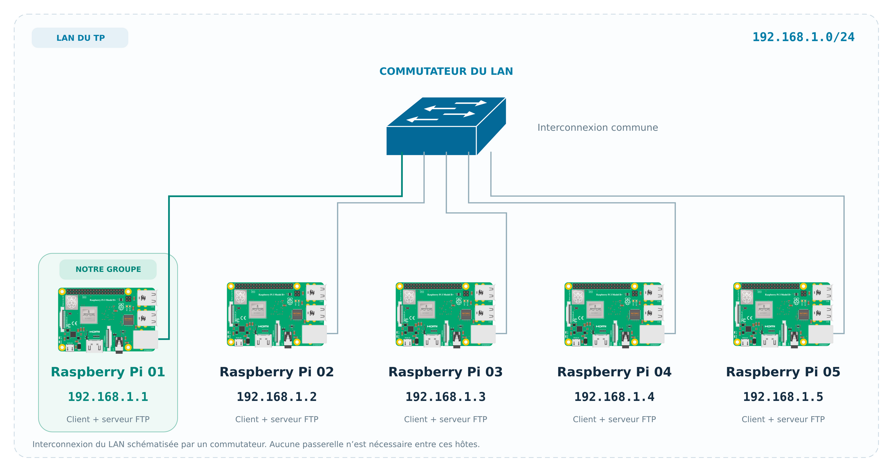
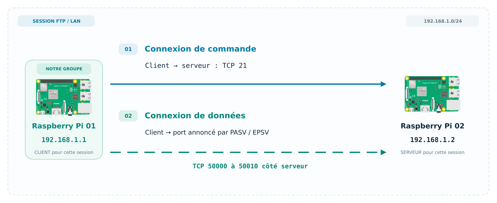

# Compte rendu du TP VSFTPD

Nous avons mis en place VSFTPD pour échanger des fichiers entre les Raspberry du TP, chacun pouvant être client et serveur FTP. Notre machine utilisait l’adresse `192.168.1.1/24`.



*Réseau du TP, avec notre Raspberry en 192.168.1.1.*

[Schéma source modifiable dans draw.io](schemas/reseau-ftp-raspberry.drawio).


## Installation et configuration

**Aucune difficulté à l’installation**, réalisée avec `sudo apt install vsftpd`.

La documentation Ubuntu nous a servi de base, mais certains passages nous ont semblé datés ou trop détaillés pour nos besoins. Dans `/etc/vsftpd.conf`, nous avons retenu `anonymous_enable=NO`, `local_enable=YES`, `write_enable=YES` et une bannière personnalisée avec `ftpd_banner`.

Les modifications se font avec `sudo nano /etc/vsftpd.conf`, puis s’appliquent et se vérifient avec :

```bash
sudo systemctl restart vsftpd
sudo systemctl status vsftpd
```

## Diagnostic de la connexion refusée

Depuis Windows, la connexion FTP était refusée. Notre première hypothèse était un filtrage par UFW, que nous avions installé. Nous avons vérifié le pare-feu puis l’état du service :

```bash
sudo ufw status
sudo systemctl status vsftpd
```

UFW était inactif. En revanche, VSFTPD était en état `failed`, avec `status=2`. Nous avons donc recherché une erreur de démarrage en lançant directement le service avec sa configuration :

```bash
sudo /usr/sbin/vsftpd /etc/vsftpd.conf
```

Le message `500 OOPS` a permis d’identifier la cause : `listen` et `listen_ipv6` étaient activés simultanément, alors que ces options sont incompatibles dans une même instance.

Nous avons d’abord testé une écoute IPv4 seule :

```ini
listen=YES
listen_ipv6=NO
```

Après redémarrage, le service est passé à `active (running)` et la connexion a fonctionné. La cause était donc une erreur de configuration empêchant le démarrage du service.

Nous avons ensuite réactivé IPv6. La configuration cohérente pour cette réactivation est :

```ini
listen=NO
listen_ipv6=YES
```

Avec le fonctionnement double pile par défaut de Linux, l’écoute IPv6 peut également accepter IPv4 sans activer les deux options simultanément.

## Essai du mode passif et retour en arrière

Le pare-feu Windows demandait des droits administrateur pour autoriser la connexion de données entrante du FTP actif. Sans ces droits, nous avons testé le mode passif, où le client ouvre les deux connexions vers le serveur, en configurant une plage de ports dans VSFTPD et les règles UFW correspondantes.

`ftp.exe`, le client natif de Windows, ne gère pas ce mode. Le test a toutefois fonctionné avec `curl.exe` :

```powershell
curl.exe --ftp-pasv --user elo-otman ftp://192.168.1.1/
```

**Malgré le test concluant avec curl, nous avons annulé ces modifications et repris la configuration précédente.**



*Mode passif testé puis abandonné. Les flèches montrent le sens d’ouverture des connexions.*

## Accès des autres groupes et droits d’écriture

Pour permettre aux autres groupes de faire leurs essais sur notre serveur, nous avons créé un compte distinct :

```bash
sudo adduser beaugosse
```

Nous avons limité les accès par chroot et autorisé l’écriture dans VSFTPD :

```ini
chroot_local_user=YES
chroot_list_enable=NO
write_enable=YES
```

Le chroot limite les utilisateurs à leur dossier personnel. Nous avons gardé sa racine sous le contrôle de `root` et réservé l’écriture au sous-dossier `depot` :

```bash
sudo chown root:root /home/beaugosse
sudo chmod 755 /home/beaugosse
sudo mkdir -p /home/beaugosse/depot
sudo chown beaugosse:beaugosse /home/beaugosse/depot
sudo chmod 700 /home/beaugosse/depot
```

`adduser` crée le dossier personnel sans attendre une première connexion ; nous devions toutefois créer `depot` et régler ses permissions. L’écriture nécessite à la fois `write_enable=YES` et les droits Linux adaptés.

Les essais d’envoi se faisaient dans ce dossier :

```text
cd depot
put fichier.txt
```

Le fichier devait être présent sur le client ; `lcd` permettait de choisir son dossier local.

## Compléments de configuration à tester

Les réglages suivants restent à tester séparément. Les observations indiquées sont les résultats attendus.

### Contrôle des comptes autorisés

Configuration commune :

```ini
userlist_enable=YES
userlist_file=/etc/vsftpd.user_list
```

Modifier la liste avec `sudo nano /etc/vsftpd.user_list`, un compte par ligne :

| Objectif | Directive | Contenu de la liste |
|---|---|---|
| Bloquer `pi` | `userlist_deny=YES` | `pi` |
| Autoriser uniquement `test` | `userlist_deny=NO` | `test` uniquement |

Le compte `test` doit exister, avoir un mot de passe et être autorisé par PAM ; au besoin, le créer avec `sudo adduser test`.

### Journaux de connexion

Les messages du service se consultent avec :

```bash
sudo journalctl -u vsftpd -n 50 --no-pager
```

Pour enregistrer les traces FTP dans un répertoire dédié :

```bash
sudo install -d -m 750 -o root -g adm /var/log/vsftpd
```

Puis configurer les journaux au format natif VSFTPD :

```ini
xferlog_enable=YES
xferlog_std_format=NO
syslog_enable=NO
vsftpd_log_file=/var/log/vsftpd/vsftpd.log
```

Suivi du fichier : `sudo tail -f /var/log/vsftpd/vsftpd.log`. `journalctl` reste utile pour les erreurs de démarrage.

### Variante du chroot demandée dans le sujet

Le sujet demande `allow_writeable_chroot=YES`, qui autorise une racine de chroot modifiable sans changer les permissions Linux. Cette variante n’est pas indispensable avec notre organisation `root` + sous-dossier `depot` inscriptible.

### Masquer les propriétaires et groupes affichés

```ini
hide_ids=YES
```

Les propriétaires et groupes apparaissent sous le nom `ftp`, sans modifier leurs droits réels.

### Connexion anonyme en lecture seule

Pour cet essai séparé, désactiver la liste de contrôle précédente afin qu’elle ne bloque pas `anonymous` :

```ini
userlist_enable=NO
anonymous_enable=YES
anon_root=/srv/ftp
anon_upload_enable=NO
anon_mkdir_write_enable=NO
anon_other_write_enable=NO
```

Préparer `/srv/ftp` avec `sudo install -d -m 755 /srv/ftp` et y placer un fichier de test lisible par tous, par exemple avec des permissions `644`.

**Résultat attendu :** `anonymous` peut lister et télécharger les fichiers publics ; l’envoi, la création de dossiers et la suppression sont refusés. Les fichiers visibles dépendent du contenu de `/srv/ftp` et des droits Linux.

### Autres options à explorer

Quelques paramètres à comparer pendant les essais : `local_umask=022` pour les permissions des nouveaux fichiers, `max_clients=10` pour limiter les sessions et `idle_session_timeout=300` pour fermer les sessions inactives.

## Documentation de référence

- [Documentation Ubuntu sur VSFTPD](https://ubuntu.com/server/docs/how-to/networking/ftp/).
- [Manuel des options de VSFTPD, notamment listen et listen_ipv6](https://manpages.debian.org/trixie/vsftpd/vsftpd.conf.5.en.html).
- [Documentation curl sur le mode passif](https://curl.se/docs/manpage.html#--ftp-pasv).
- [Microsoft sur FTP actif et passif et le pare-feu Windows](https://learn.microsoft.com/en-us/iis/publish/using-the-ftp-service/configuring-ftp-firewall-settings-in-iis-7#more-information-about-working-with-firewalls).

*Icônes des schémas : [Amperka](https://github.com/amperka/hardware-drawings), [CC BY-NC-SA 4.0](https://creativecommons.org/licenses/by-nc-sa/4.0/), et [Cisco](https://www.cisco.com/c/en/us/about/brand-center/network-topology-icons.html).*
